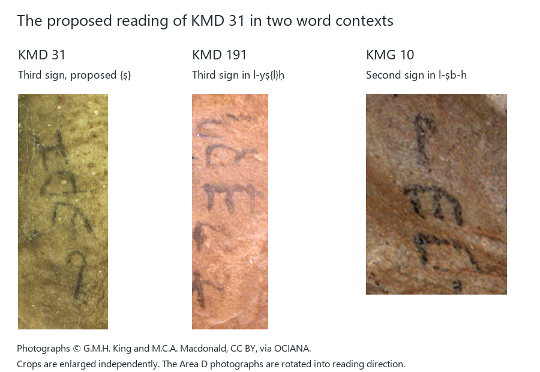

# Dhofari cave panel KMD 28–31

Four painted columns at site D2, Dhofar, Oman. The date of painting is unknown. The field survey recorded the panel in 1991–92. KMD 28–30 preserve an alphabet exercise in Dhofari Script 1a. The function of the rightmost column, KMD 31, remains open. [OCIANA record, photographs and tracing](https://ociana.osu.edu/inscriptions/46218)

## Published readings

The [transcription](transcription.tsv) follows the signs down each column. Braces mark uncertain identifications and a question mark marks the unresolved sign. KMD 29 starts physically with `dġṭ`, above `s¹kn` and `ʿḍg`. The 2026 edition presents these groups in their reconstructed alphabetic order. For KMD 28, its `zyṯẓ` corresponds to OCIANA’s `zys³ṣ`. [Field survey, p. 77 and fig. 26](https://archive.org/details/DhofarEpigraphicProject) · [2026 edition, table 2 and Appendix 1](https://doi.org/10.1093/jss/fgag018)

Al-Jallad’s 2025 study recognized the first thirteen signs of KMD 30 and compared them with KMG 120–126. Clearer photographs led Al-Jallad and Prioletta to revise the rest of the column to `{d}ġṭ ḫfʾ ʿ{ḍ}`. KMG 125 supplies the first group and KMG 126 the second. KMD 29 shows a complete `ʿḍg`. At the foot of KMD 30, the editors interpret a filled spot as `ʿ` and a cross as the beginning of a crossed circle, `ḍ`. The surviving cross leaves the final identification provisional. [2025 study, figs. 2–6](https://www.academia.edu/129778573/) · [Revised edition, images 9–11](https://doi.org/10.1093/jss/fgag018)

## KMD 31 hypothesis

OCIANA gives `zy?l`. We propose **`zy{ṣ}l`** if the writer used the Script 1a sign values. The field survey printed the same symbol for KMD 31’s third sign and KMD 28’s fourth. In fig. 26 both have three descending strokes, although the upper stroke curves more in KMD 31. KMD 28’s third sign, the one predicted by a literal copy of the alphabet ending, has two loops. [Field survey, p. 77 and fig. 26](https://archive.org/details/DhofarEpigraphicProject)

Two comparisons test the hypothesis outside an alphabet list. KMG 10 has a curved three-legged sign read as `ṣ` beside a two-legged `b`. KMD 191 places the comparable sign after `y` in `l-yṣ{l}ḥ`. Its editor also considers `yṣbḥ`, retaining `ṣ` in either reading. KMD 31 lacks the final `ḥ`, so the prayer in KMD 191 supplies no translation of KMD 31. [KMG 10–13](https://ociana.osu.edu/inscriptions/45816) · [KMD 189–191](https://ociana.osu.edu/inscriptions/45829)

Photographs by G.M.H. King and M.C.A. Macdonald, marked CC BY in the linked OCIANA records. Cropped, rotated where necessary, and enlarged independently for comparison.

## Remaining gaps

- **KMD 30.** A separate exposure showing part of an enclosing circle would distinguish an incomplete or damaged `ḍ` from a complete cross-shaped sign.
- **KMD 31.** The short column could be an imitation. Script 2 also has a three-toothed sign whose value is debated. The corpus note mentions Script 1b and Script 2 parallels and calls the puzzling sign the second glyph, while the transcription puts the question mark third. Their inscription numbers would clarify which position the comparison concerns. [OCIANA commentary](https://ociana.osu.edu/inscriptions/46218) · [Script 2 study, pp. 3–5, 44–45](https://doi.org/10.5281/zenodo.17276961)
- **Final hook.** If the alphabet wraps from `z y ṯ ẓ` back to `h l`, keeping any one of `ṯ`, `ẓ`, or `h` between `zy` and `l` costs two omissions. This exercise cannot distinguish their values. The column has no secure translation.
